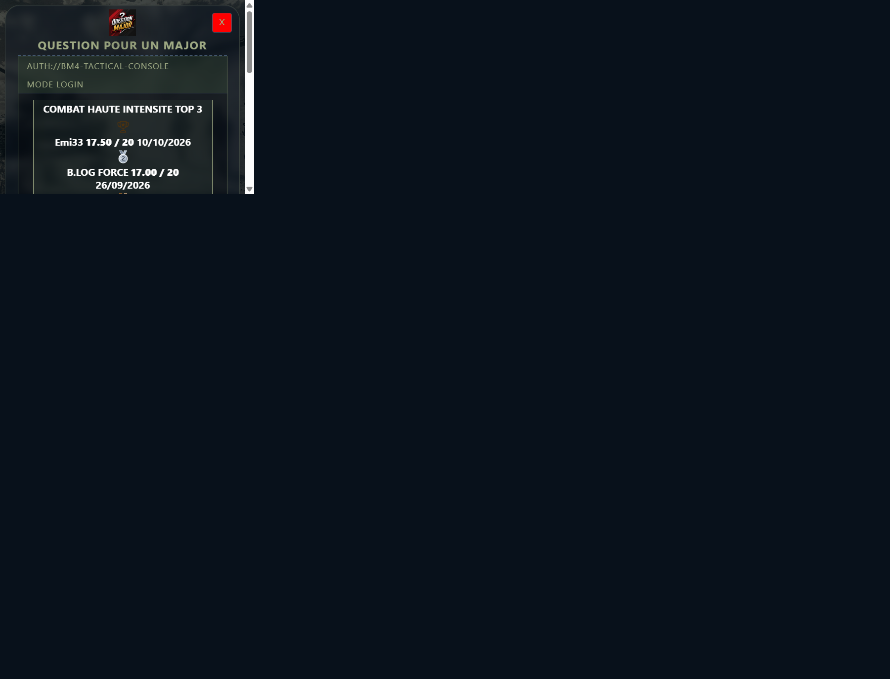
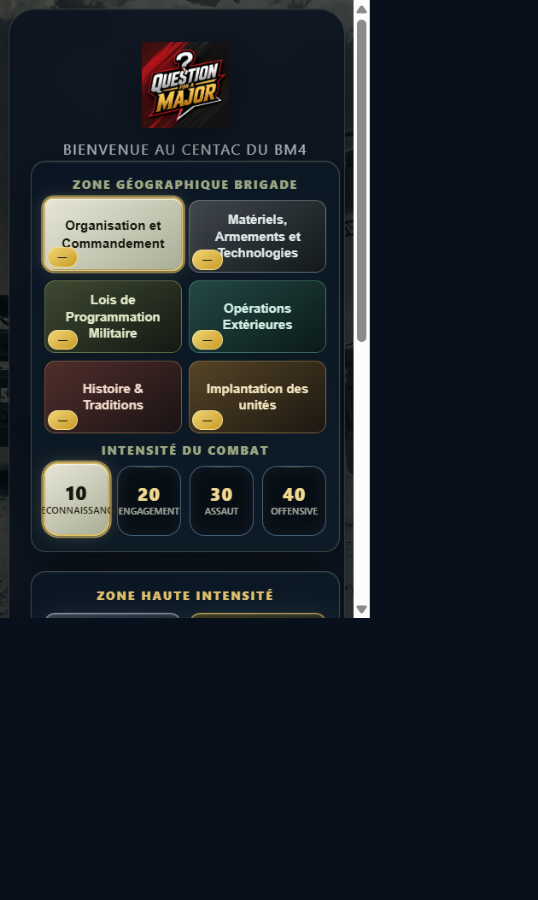
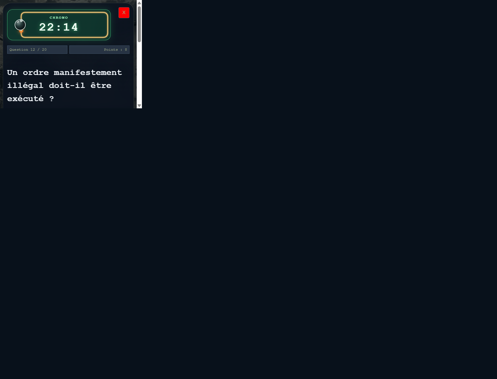
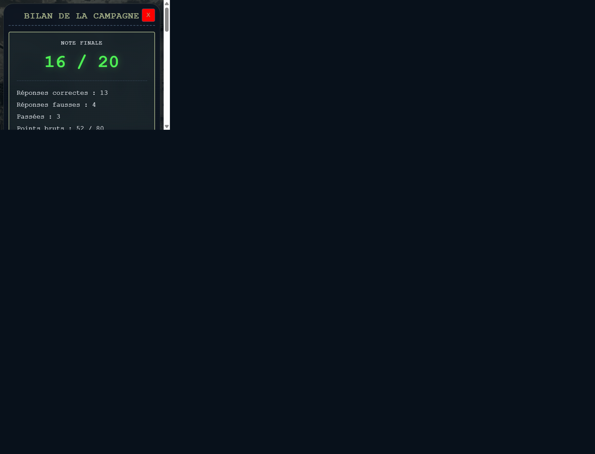
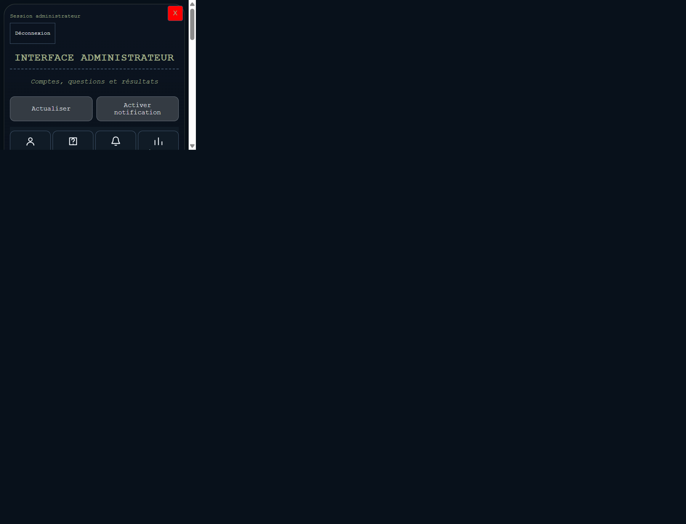

# Question pour un Major - Édition Tactique

Application web de préparation au Brevet Militaire de 4e niveau (BM4), pensée comme un QCM tactique en navigateur pour les candidats et une interface d’administration pour les gestionnaires de contenu.

<p align="center">
  <strong>QCM-MAJOR</strong> • PWA • Supabase • GitHub Pages • Formation militaire BM4
</p>

## Vue d’ensemble

QCM-MAJOR transforme la préparation au BM4 en une experience immersive, rapide et mobile-first. L’application met en avant un parcours clair pour les candidats, un suivi pédagogique solide et une gestion administrative fluide pour les formateurs.

### Pourquoi ce projet ?

- une préparation au BM4 accessible depuis un navigateur mobile ou desktop ;
- un rythme de quiz immersif inspiré d’un entraînement de combat ;
- une expérience de révision plus motivante grâce au scoring, aux classements et au suivi d’historique ;
- une gestion de contenu centralisée pour les admins, sans backend lourd ni dépendance complexe.

### Ce que propose l’application

- inscription et connexion candidat avec Supabase Auth ;
- campagne globale ou entraînement par thème ;
- mode “COMBAT DE HAUTE INTENSITE” avec chrono et pression temporelle ;
- synthèse finale avec réponses correctes, fausses, passées et points ;
- signalement d’erreurs sur les questions ;
- espace d’administration pour gérer comptes, questions, résultats et signalements.

Le projet est conçu pour être hébergé facilement sur GitHub Pages ou sur tout autre support statique, avec Supabase pour l’authentification, le stockage des données, les résultats et les notifications.

## Fonctionnalités principales

### Espace candidat

- inscription via Supabase Auth ;
- connexion avec email/mot de passe ;
- vérification OTP à l'inscription ;
- récupération de mot de passe ;
- campagne globale de révision ;
- entraînement thématique ;
- mode "COMBAT DE HAUTE INTENSITE" avec chrono ;
- scoring, réponses correctes/fausses/passées ;
- écran de conclusion avec synthèse pédagogique ;
- signalement de question avec commentaire optionnel.

### Espace administrateur

- gestion des comptes et profils ;
- gestion des questions (ajout, édition, suppression, dédoublonnage) ;
- consultation des signalements ;
- suivi des résultats et des listes de candidats ;
- filtrage, recherche et statistiques ;
- accès sécurisé via les rôles Supabase (`app_metadata.role = admin` ou `app_metadata.bm4_admin = true`).

### Expérience mobile et PWA

- interface adaptée mobile et bureau ;
- affichage en plein écran / écran d'accueil ;
- icônes, splash screens et thème visuel militaire ;
- notifications push pour les signalements côté admin Android/Chrome ;
- fallback local via `localStorage`.

## Screenshots / captures

Quelques captures réelles de l’interface du projet pour illustrer les parcours clés :

### Authentification et Top 3 public



### Sélection de mission / préparation au combat



### Quiz en mode "COMBAT DE HAUTE INTENSITE"



### Bilan final candidat



### Gestion des questions et signalements côté admin




## Stack technique

- Frontend : HTML5, CSS3, JavaScript Vanilla
- Authentification : Supabase Auth
- Base de données / logique applicative : Supabase
- Stockage local : navigateur (`localStorage`)
- Hébergement : GitHub Pages ou autre static hosting
- PWA : `manifest.json`, service worker, assets graphiques

## Structure du dépôt

```text
QCM-MAJOR/
├── index.html                  # Point d'entrée de l'application
├── app.js                      # Coordination générale des modules
├── manifest.json               # Configuration PWA
├── service-worker.js           # Service worker / notifications
├── ui/
│   └── Style.css               # Styles applicatifs
├── public/
│   ├── audio/                  # Sons tactiques
│   ├── icons/                  # Icônes PWA
│   ├── images/                 # Logos et visuels
│   └── splash/                 # Splash screens mobile
├── modules/
│   ├── questions-bank/         # Banque de questions et thèmes
│   ├── quiz-engine/            # Moteur du quiz et scoring
│   ├── report-notifications/   # Gestion notifications
│   ├── startup-recovery/       # Restauration de session
│   └── ui-controller/          # Contrôle de l'interface
├── supabase/
│   ├── config.toml             # Configuration des Edge Functions
│   ├── functions/
│   └── migrations/             # Scripts SQL de base de données
├── tests/                      # Tests fonctionnels et UI
├── README.md                   # Documentation du projet
└── ...
```

## Démarrage local

Aucune étape de build n'est nécessaire pour démarrer le site.

1. Cloner le dépôt :

```bash
git clone https://github.com/domino2801-cmyk/QCM-MAJOR.git
cd QCM-MAJOR
```

2. Démarrer un petit serveur web local :

```bash
python -m http.server 8000
```

Puis ouvrir :

```text
http://localhost:8000
```

Le projet est conçu pour être servi via HTTP. Éviter l'ouverture directe du fichier `index.html` dans certains navigateurs si besoin de tester la configuration Supabase et les modules ES.

## Configuration Supabase

L'application attend au minimum les métadonnées suivantes dans `index.html` :

```html
<meta name="supabase-url" content="https://your-project.supabase.co">
<meta name="supabase-anon-key" content="your-anon-key">
<meta name="supabase-profiles-rls" content="verified">
```

### Prérequis côté Supabase

- activer le fournisseur Email pour l'inscription et la récupération de mot de passe ;
- configurer les redirect URLs d'authentification ;
- prévoir une table `profiles` avec les informations de compte utilisateur ;
- prévoir les tables `questions`, `quiz_results` et la table de signalements ;
- sécuriser les accès avec les politiques RLS adaptées ;
- configurer les rôles administrateurs via `app_metadata.role = admin` ou `app_metadata.bm4_admin = true`.

Les migrations du dossier `supabase/migrations/` doivent être appliquées selon le besoin du déploiement, notamment pour les signalements, le Top 3 public, la distinction entre simulation et combat haute intensité dans l'historique, et les autorisations d'administration.

### Top 3 public

Le classement affiché avant connexion est chargé par la fonction RPC publique `get_public_global_campaign_top3()`. Cette fonction renvoie uniquement le pseudo, la note et la date des trois meilleurs résultats globaux (`theme = 'all'`), sans accès anonyme direct à la table `quiz_results`. Appliquez la migration `20260926082000_create_public_global_campaign_top3_view.sql` pour activer ce classement.

## Notifications et déploiement

Le projet supporte :

- les notifications de signalement côté admin ;
- le déploiement statique sur GitHub Pages ;
- l'installation en tant qu'application sur mobile ;
- la gestion de contenu avec Supabase sans backend Node.js dédié.

Pour la partie push, la configuration nécessite des secrets VAPID, un webhook et la fonction Edge `report-push` dans Supabase. Voir le dossier `supabase/functions/` et les migrations associées pour le détail opérationnel.

## Documentation juridique et conformité

Une partie du site inclut des écrans de mentions légales et de politique de confidentialité sans dépendre d'un routeur serveur.

Avant publication, vérifier que :

- les textes juridiques correspondent à l'hébergement réel ;
- les informations de contact, hébergement et base légale sont correctes ;
- les politiques de conservation et de transfert sont cohérentes avec l'usage des données.

## Qualité et tests

Le dépôt contient une suite de tests fonctionnels dans le dossier `tests/` pour couvrir les principales parcours :

- authentification et inscription ;
- question bank et thèmes ;
- résultats, historique et classement ;
- écrans statiques et parcours de quiz ;
- notifications et modules de récupération.

## À retenir

QCM-MAJOR est une application web de préparation au BM4, orientée mobile, avec un front statique et un back Supabase. Elle combine quiz, gestion de contenu, performance visuelle et fonctionnalités administratives dans un seul projet léger et facilement déployable.

---

Pour toute contribution, il est recommandé de garder la logique métier dans les modules du dossier `modules/`, les styles dans `ui/Style.css`, et d'éviter les modifications directes dans le HTML sauf si le besoin concerne la structure ou les métadonnées de configuration.
